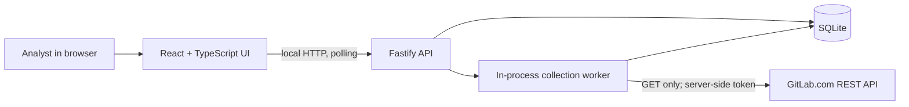

# Technical design: GitLab evidence collector

**Status:** implemented and verified locally with 53 server tests, 10 browser tests, and a production build. The live baseline, force-push change, and restored setting are recorded as runs 11-13 with screenshots and a video linked in [README.md](README.md#live-demonstration-evidence). The local mock demo records failure and recovery. CI runs on every push and has passed on GitHub Actions; the manual accessibility review remains outstanding. This design fits the assessment's one-user local scope.

## The design problem

An analyst needs an answer to three questions: **What did GitLab report? What could we not collect? What changed since a known earlier observation?** Each answer must include its source and collection time. A failed read must never be presented as a confirmed setting or erase a past successful observation.

### Non-negotiable invariants

1. Every run stores the exact requested project IDs and eventually has one durable outcome per ID.
2. A protected/unprotected claim requires a successful GitLab branch read. An empty-repository claim requires `empty_repo: true` plus an empty actual branch list.
3. Missing, unreadable, and not-applicable values are distinct. A failed collection never becomes a posture change.
4. Completed evidence and comparison baselines remain identifiable after browser refresh or server restart.
5. The GitLab token stays in the server process. Every GitLab request is `GET` to `gitlab.com`.
6. A run left active by a stopped process becomes `interrupted` on restart; it never appears to run forever.

## System boundary

Node.js 24 LTS and npm workspaces host a Vite client and Fastify server. Node's built-in `node:sqlite` provides local SQLite storage, avoiding a native addon build requirement on reviewers' Windows machines. It is a release-candidate Node API, so Node 24 is pinned and tests cover storage/restart behavior. The HTTP handler creates a durable run and returns promptly; the worker performs GitLab I/O outside the request. The browser polls run state and reloads it after refresh. This avoids a second queue service for a single local user. A deployment with multiple server replicas would need a separate durable job runner and shared storage; that is outside this assessment.

### Deliberate tradeoffs

| Decision | Why it fits this assignment | Upgrade trigger |
| --- | --- | --- |
| SQLite instead of a hosted database | Gives transactional, restart-safe local history with no external service to provision. | Multiple app instances or shared analyst access. |
| In-process worker instead of a queue service | Keeps the one-user deployment inspectable while durable run rows make interruption explicit. | Independent worker scaling, scheduled collection, or guaranteed job replay. |
| HTTP polling instead of WebSockets | Refresh reconnection depends on stored state, not a live connection; polling is sufficient for short runs. | High-frequency progress or many concurrent users. |
| Selected provider evidence plus normalized display data | Keeps the UI simple without losing the fields needed to explain a conclusion. | A formal audit export or longer retention policy requiring immutable raw response archives. |

These are design choices, not claims that the assessment mandates particular frameworks or storage engines.

## Evidence contract

For each requested numeric ID, the collector reads:

| Source | Endpoint | Facts retained |
| --- | --- | --- |
| Project | `GET /projects/:id` | Returned stable ID, name, `web_url`, visibility, `empty_repo`, project-level `default_branch`. |
| Empty-repo check | `GET /projects/:id/repository/branches` | Whether any actual branch exists when `empty_repo` is true. |
| Default branch | `GET /projects/:id/repository/branches/:branch` | Actual branch name and GitLab's `protected` boolean for a non-empty repository. |
| Protection rules | `GET /projects/:id/protected_branches` | Every page of visible rule names and returned push, merge, unprotect, force-push, and code-owner fields. |

The live seed responses exposed a critical mismatch: the empty project returned `empty_repo: true` and `default_branch: "main"`, but its branch list was `[]` and a read of `main` returned `404`. We therefore store the project field as **reported metadata** and treat actual branch existence separately.

The branch endpoint is authoritative for GitLab-reported protected status. Visible protected-branch rules explain configuration but do not prove individual effective permissions. An exact `main` rule can be tied to `main`; documented `*` patterns may be identified as potentially applicable. Ambiguous wildcard or inherited/group behavior remains labeled as a coverage limit. We will not turn all project rules into a calculated effective permission set or count changes to unrelated rules as changes to the default branch.

Each logical source read records endpoint reference, start/finish time, HTTP status or safe error code, attempt count, and whether required fields were returned. Selected response fields are stored; authorization headers, raw error bodies, and the token are not. An omitted field is not normalized to `false` or `[]`.

These API calls are not an atomic snapshot. If a default branch is renamed or removed between the project and branch reads, the collector records the inconsistency and marks the project partial. A later run can resolve it.

## Persistence model

Schema version 3 contains four tables. The first migration creates the evidence/configuration tables; version 2 added a process-ID ownership table, which version 3 drops because ownership is now an OS-held lock on a separate `evidence.sqlite.lock` file. Existing databases upgrade in place. JSON columns preserve selected provider structures without forcing every GitLab access-level variant into its own table; typed application validation governs their shape.

| Table | Key fields | Why it exists |
| --- | --- | --- |
| `selection` | singleton key, ordered `project_ids_json`, `updated_at` | Persist the analyst's saved selection. |
| `runs` | ID, requested IDs snapshot, state, created/started/finished times | Preserve what was requested even if selection changes later. |
| `run_projects` | `(run_id, requested_project_id)`, state, returned ID, selected evidence JSON, safe error, times | One durable outcome per requested ID, including partial evidence. |
| `source_reads` | run/project/source/request-sequence key, endpoint reference, state, HTTP status, attempts, times, selected response JSON | Explain each API call, including individual pagination pages, and retain provenance. |

Use foreign keys, transactions, WAL mode, and a busy timeout. Store the database under ignored `data/`. Migrations run before the server accepts requests. A database-level uniqueness constraint plus a transaction enforces one queued/running run at a time. Terminal run records are not edited except for explicitly documented repair/migration procedures.

### States

| Level | States | Meaning |
| --- | --- | --- |
| Source read | observed, confirmed_absent, not_applicable, unreadable | Distinguish a successful empty response, an intentionally skipped read, and a failed request. |
| Project | pending, running, complete, partial, failed, interrupted | Complete means all required evidence for that project's state is readable; partial means useful evidence exists but a required step failed; failed means project identity itself cannot be read. |
| Run | queued, running, completed, partial, failed, interrupted | Completed means every project is complete; partial means some useful evidence exists but not all projects are complete; failed means no requested project yielded useful evidence. |

Before opening or migrating SQLite, startup takes an exclusive lock on `evidence.sqlite.lock` (SQLite `locking_mode = EXCLUSIVE` on a separate file, `DataDirectoryLock` in `lock.ts`). The operating system holds that lock for as long as the server process lives, so a second server refuses to start while the first is alive, even if the first is paused or busy, and the lock is released the moment the owner exits for any reason. This replaced an earlier process-ID lease: ownership by process ID cannot distinguish a dead server whose ID was reused from a live one, and a heartbeat deadline cannot prove a paused process has stopped writing. The OS lock has neither problem. Graceful shutdown drains collection and then releases the lock; a failed port bind also releases it. A hung server must be stopped by the operator.

Recovery changes persisted queued/running runs and pending/running project rows to `interrupted`, retaining committed source reads and checkpointed evidence. Terminal outcome updates cannot overwrite completed or interrupted records. Unexpected per-project failures preserve checkpoints as partial evidence, and persistence errors are not mislabeled as malformed GitLab responses. A new run is the recovery path; automatically replaying a half-finished run could mix GitLab settings observed at different times.

## Collection algorithm

1. Validate the saved selection: numeric positive IDs, no duplicates, non-empty, and within a documented local capacity limit. Reject invalid input; never silently drop an ID.
2. In one transaction, snapshot the selected IDs into a new run, insert every `run_projects` row as `pending`, and reserve the single active-run slot. Return `202` with the run ID. A concurrent start returns `409` and the active run ID.
3. Process up to two projects concurrently. Within each project, read the project first, then the appropriate branch/branch-list endpoint, then all protection-rule pages where applicable. Persist each logical read before moving on so a crash retains partial evidence.
4. Validate response shape at the boundary. Convert HTTP/network/parse failures into typed, sanitized outcomes. Classify `401`, `403`, and `404` separately; a project `404` may mean missing **or** inaccessible. A branch `404` after a non-empty project read is inconsistent, not unprotected.
5. Retry timeouts, network failures, `429`, and transient `5xx` with bounded attempts and exponential backoff plus jitter. Honor `Retry-After` when it fits the 30-second budget for that logical read; otherwise finish as rate-limited. The UI advises waiting for the provider window but does not retain an exact retry timestamp. Do not retry permanent authorization or validation errors. Never manufacture real rate-limit traffic for tests.
6. Follow GitLab pagination's `Link: rel="next"`, with a page cap and a `gitlab.com` origin/path check before forwarding the token. A short page alone does not prove pagination ended. Reject cross-origin redirects for the same reason.
7. Finalize every project row and then the run in transactions. A source-read failure preserves previously committed facts and the last successful observation from earlier runs.

The collector processes two projects concurrently, supports up to 20 selected projects, and reads at most 20 rule pages per project. Requests have an 8-second timeout and at most three attempts. The 30-second retry budget is per logical read, not per project or run.

## Local API and UI

| Local route | Purpose |
| --- | --- |
| `GET /api/selection`, `PUT /api/selection` | Read and save numeric project IDs. |
| `POST /api/runs` | Start collection from a snapshot of the saved selection; respond immediately. |
| `GET /api/runs/active` | Reconnect after refresh. |
| `GET /api/runs`, `GET /api/runs/:id` | History and per-project/source outcomes. |
| `GET /api/projects/:id/history` | Project observations and last complete evidence. |
| `GET /api/runs/:id/changes` | Changes with per-project baseline run IDs and times. |

The UI needs three focused views: **Dashboard** (selection, start, active progress), **Run detail** (every requested project, source status, errors, next action, last-good evidence), and **History/comparison** (older runs, baseline, meaningful changes). Poll only while a run is active. On refresh, reload selection, active run, and current history from SQLite. Use semantic controls, visible status text, keyboard access, and clear timestamps; charts are unnecessary.

For a failed newest attempt, show “Latest attempt failed” next to “Last successful evidence from [time/run]”; label that evidence as older. For an empty repository, show “No actual default branch” rather than “Unprotected.” For a protected branch with unreadable rules, show “Protected; restrictions not fully collected” and a retry/access-check action.

## Comparison policy

- The baseline for a project is its most recent **prior complete** observation. Identify both run IDs and timestamps. Skip intervening partial/failed attempts as baselines, while showing that they occurred.
- Compare actual branch existence/name, GitLab `protected` status, and returned fields in applicable protection rules. Normalize access entries into stable tuples and sort them; ignore provider record IDs, response order, and fetch timestamps.
- Keep omitted/unknown fields distinct from explicit `false`, empty arrays, or confirmed absence. Every applicable rule field missing from either or both observations is listed as not compared. Coverage loss is not a confirmed protection change. Do not compare a partial current result as though it were a full posture snapshot. With no earlier complete baseline, use neutral wording that does not imply this observation is complete.
- For a partial current result, compare only successfully observed facts against the last complete baseline and explicitly list what was not compared. Partial results never become baselines.
- Treat empty-to-initialized and default-branch replacement as explicit transitions. If rule applicability cannot be established confidently, show the raw rule context and mark that comparison as limited.

The recorded live demo manually toggled **Allowed to force push** on the synthetic protected `main` branch between UI collections. Runs 11-13 show `false -> true -> false`, including restoration; each comparison identifies its prior complete baseline. The screenshots and recording are linked in the README.

## Test strategy and release gates

| Layer | Critical checks |
| --- | --- |
| Pure unit tests | Empty-repo metadata mismatch, field presence versus omission, normalization, comparison baseline, wildcard applicability boundaries, error classification, retry-budget calculation. |
| Server/DB integration | Save selection and restart; run snapshot; one-active-run conflict; per-ID outcomes; partial read persistence; startup interruption; data directory lock held against a second process and released by the OS when the holder is killed; terminal outcome guards; migration from v1 and v2 to v3; foreign Host/Origin refusal; storage errors kept distinct from provider errors. |
| Browser tests | Full successful collection and partial failure/recovery through the real backend and UI, with GitLab HTTP mocked and no credential. Check refresh reconnection, latest versus last-good, neutral baseline wording, staleness, process restart, and delayed refresh ordering. |
| Live acceptance | Two UI collections of all three real projects, manual GitLab change, correct comparison, sanitized screenshots, and no token or private data in artifacts. |

The repeatable mocked failure demo makes one protected-rules read return a transient error beyond the retry budget, shows partial evidence and the recovery action, then succeeds on a subsequent run. Its mode is explicit and ignores the live token. [MANUAL_TESTING.md](MANUAL_TESTING.md) maps recorded scenarios and additional review regressions to tests without claiming the old recording covers newly added cases.

The implementation, failure demo, browser tests, live artifacts, and setup documentation are present. The [CI workflow](.github/workflows/ci.yml) installs locked dependencies and Chromium on Windows, then runs server tests and the build/browser suite using the pinned Node version. Local verification has passed, and the workflow has passed on GitHub Actions from a clean checkout. The manual accessibility review is not yet recorded.

## Main risks and limits

- **Evidence correctness:** GitLab's empty project reported a configured branch name without an actual branch. The data model and tests preserve this distinction.
- **Rule coverage:** wildcard and inherited rules can affect effective behavior. The branch status is reported directly; visible rules are retained with provenance and limits. No individual permission calculation or separate group traversal is promised.
- **Non-atomic provider reads:** mid-run GitLab changes can yield inconsistent results. Mark them incomplete and recollect.
- **Local-process crash:** source reads committed before the crash survive; active rows become interrupted on restart. Automatic distributed resume is unnecessary for one local server.
- **Storage API maturity:** Node 24's built-in SQLite API is a release candidate, not yet stable. Pin the tested Node 24 version and cover migrations, persistence, and restart behavior with tests; revisit the adapter for a deployed product.
- **Scope discipline:** do not add sign-in, scoring, webhooks, scheduling, GitLab write actions, or a cloud deployment to this assessment.

## Sources and verification

This design is based on the supplied two-page assessment, [GitLab Projects API](https://docs.gitlab.com/api/projects/), [Branches API](https://docs.gitlab.com/api/branches/), [Protected branches API](https://docs.gitlab.com/api/protected_branches/), [REST pagination](https://docs.gitlab.com/api/rest/#pagination), [protection-rule behavior](https://docs.gitlab.com/user/project/repository/branches/protection_rules/), and [SQLite WAL documentation](https://www.sqlite.org/wal.html). The protected, unprotected, and empty seed responses were verified live through the verifier and collector. Automated tests exercise the implementation, and the README links the existing live UI acceptance artifacts. Follow-up fixes were verified using synthetic data and did not alter GitLab settings.
