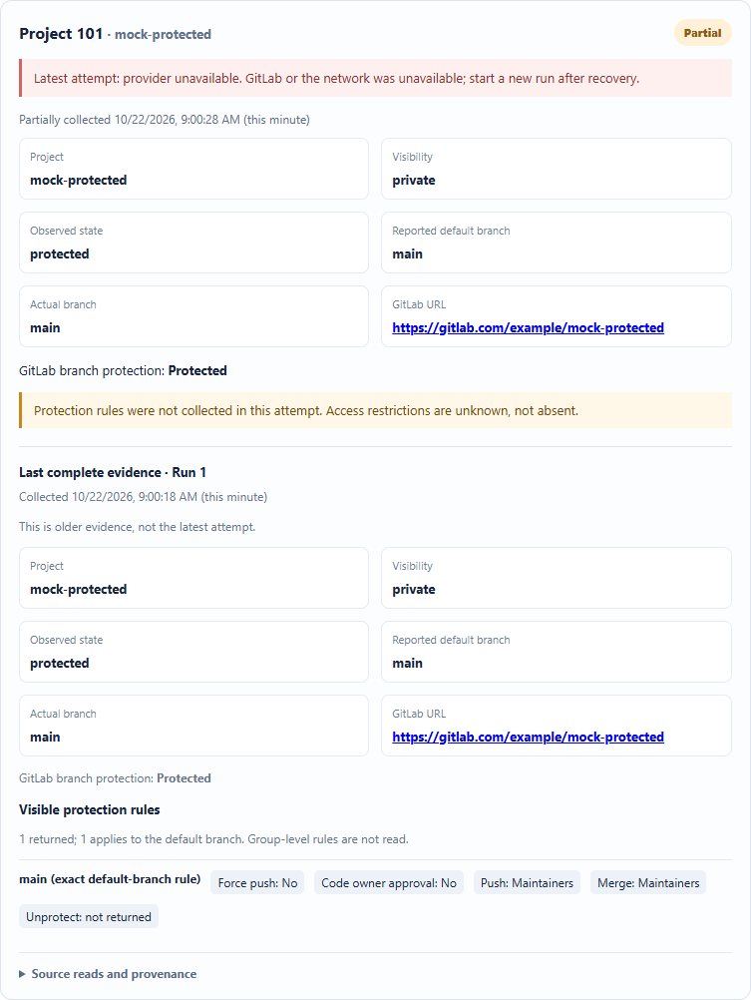
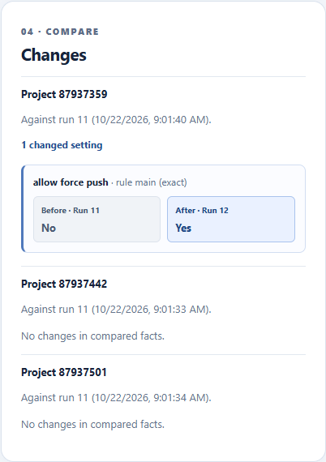

# GitLab compliance integration

A local, read-only tool for a compliance analyst to collect GitLab.com branch-protection evidence, investigate collection failures, and understand how a project's protection posture changes between collections.

**Status:** implemented and verified. 42 server tests and 4 browser tests pass on Node.js 24.19.0. A live two-collection demonstration against real GitLab.com projects is recorded under [Live demonstration](#live-demonstration-evidence).

▶ **[Watch the demo videos](https://mohan1544.github.io/gitlab-compliance-integration/demo/)** (mocked partial failure and recovery, and the live GitLab.com change), playable in the browser. GitHub's file view downloads `.webm` files rather than playing them, so the videos are served through GitHub Pages.

- [Quick start](#quick-start)
- [Mocked partial-failure demo](#mocked-partial-failure-demo)
- [Tests](#tests)
- [Live demonstration evidence](#live-demonstration-evidence)
- [API choices, permissions and coverage](#api-choices-permissions-and-coverage)
- [Design decisions](#design-decisions)
- [Reliability and recovery](#reliability-and-recovery)
- [Evidence states, staleness and comparison policy](#evidence-states-staleness-and-comparison-policy)
- [Data model](#data-model)
- [Assumptions](#assumptions)
- [Known limitations](#known-limitations)
- [What I would change for production](#what-i-would-change-for-production)
- [AI usage and verification](#ai-usage-and-verification)

## Quick start

**Node.js 24.19.0** is required (pinned in [.nvmrc](.nvmrc)). The build, test and dev scripts first run [scripts/check-node.mjs](scripts/check-node.mjs), and `npm ci` enforces the `engines` range (`engine-strict`). The check stops with a clear message on any other major version; Node 20 cannot run this project because storage uses Node 24's built-in `node:sqlite`. Commands are for PowerShell, from the repository root.

```powershell
node --version   # must print v24.x
npm ci
Copy-Item .env.example .env
```

Edit `.env` and set `GITLAB_TOKEN` to a personal access token with **only** the `read_api` scope that can read your seed projects (see [Create the test environment](#create-the-test-environment)). `.env` is gitignored; never commit or share it. `GITLAB_PROJECT_PATHS` is used only by the optional seed verifier.

Start the API and the UI in two terminals:

```powershell
npm run dev:server
```

```powershell
npm run dev:web
```

Open http://127.0.0.1:5173, enter the numeric project IDs (for the seed projects: `87937359, 87937442, 87937501`), click **Save selection**, then **Start collection**.

**Storage setup** is automatic: the server creates `data/evidence.sqlite` (gitignored) and applies the schema migration on startup. No separate database step is needed. The API binds only to `127.0.0.1:3001`, and Vite proxies `/api` to it. The token stays in the server process; the browser never receives it.

### Create the test environment

[GITLAB_SEED_GUIDE.md](GITLAB_SEED_GUIDE.md) has step-by-step instructions to create a free GitLab.com account, three synthetic projects (protected, unprotected, empty), and a `read_api` token. To check the seed states without the app:

```powershell
node --env-file=.env scripts/verify-gitlab.mjs
```

The script sends only `GET` requests, puts the token in the `PRIVATE-TOKEN` header, and never prints it.

## Mocked partial-failure demo

This needs no GitLab token or network access. In one terminal:

```powershell
$env:MOCK_GITLAB_SCENARIO = "partial-recovery"; $env:MOCK_GITLAB_DELAY_MS = "600"; $env:DATA_DIR = "$PWD\data\mock-demo"; npm run dev:server
```

In a second terminal, run `npm run dev:web` and open http://127.0.0.1:5173. Mock mode ignores `.env`, uses its own database, pre-selects IDs `101, 102, 103`, and labels the UI as a mock. `MOCK_GITLAB_DELAY_MS` (0–10000) slows each mocked response so progress and mid-run refresh are visible. Click **Start collection** three times:

1. **Run 1:** all three projects complete (protected, unprotected, empty). Refresh the page during the run: it reconnects and finishes on its own.
2. **Run 2, partial failure:** the protected project's rules endpoint returns `503` for all 3 attempts. The project is *partial*. Its card shows *Latest attempt: provider unavailable* with a next action, the protected flag that **was** read, a warning that restrictions are unknown rather than absent, and the last complete evidence from run 1, labelled as older. The comparison compares only what was observed and lists the rest as *not compared*.
3. **Run 3, recovery:** the analyst starts a new run. It completes, and the comparison against **run 1** (the last complete baseline, skipping partial run 2) shows *allow force push: No → Yes*.

The scenario repeats every three runs and is keyed to the stored run ID, so a server restart does not reset it. Delete `data/mock-demo` to start again from run 1.

**Recording:** [watch it in the browser](https://mohan1544.github.io/gitlab-compliance-integration/demo/) (48 s, captioned), or download [mock-demo.webm](docs/demo/mock/mock-demo.webm). Locally, [docs/demo/index.html](docs/demo/index.html) plays every demo video on one page. It shows all three runs, including the mid-run refresh. Screenshots:

| Step | Screenshot |
| --- | --- |
| Ready, IDs saved | [mock-01-ready.png](docs/demo/mock/mock-01-ready.png) |
| Run 1 running | [mock-02-run1-running.png](docs/demo/mock/mock-02-run1-running.png) |
| Run 1 after a browser refresh: reconnected, still running | [mock-03-run1-reconnected-after-refresh.png](docs/demo/mock/mock-03-run1-reconnected-after-refresh.png) |
| Run 1 complete: protected, unprotected, empty | [mock-04-run1-complete.png](docs/demo/mock/mock-04-run1-complete.png) |
| Run 2 partial failure | [mock-05-run2-partial-failure.png](docs/demo/mock/mock-05-run2-partial-failure.png), [project card](docs/demo/mock/mock-06-run2-partial-project-card.png), [partial comparison](docs/demo/mock/mock-07-run2-partial-comparison.png) |
| Run 3 recovery, compared with run 1 | [comparison](docs/demo/mock/mock-08-run3-recovery-comparison.png), [full page](docs/demo/mock/mock-09-run3-recovered.png) |

 [MANUAL_TESTING.md](MANUAL_TESTING.md) has further manual scenarios: total failure, mixed outcomes, unsaved selection, refresh, and restart.

## Tests

```powershell
npm test            # 42 server tests (Vitest), about 1 s
npx playwright install chromium   # once: downloads Playwright's bundled Chromium
npm run test:e2e    # builds, then 4 browser tests (Playwright), about 20 s
```

To use an installed Google Chrome instead of the bundled Chromium, run `$env:PLAYWRIGHT_CHANNEL = "chrome"` before `npm run test:e2e`.

No test needs GitLab credentials or network access. GitLab is mocked only at the HTTP transport boundary, using response shapes from the documented API, so the real client, collector, store, API and UI all run. The browser suite starts its own mock API (port 3101) and UI (port 5273) with a temporary database, so it can run alongside the live app.

### What the tests cover and why

Tests target the places where a wrong answer looks like a right one: a failed read shown as a confirmed setting, a non-change reported as a change, or lost history.

| Area | Cases | Why |
| --- | --- | --- |
| GitLab boundary ([gitlab.test.ts](apps/server/src/gitlab.test.ts)) | `Retry-After` honoured, and refused when it exceeds the request budget; 401/403/404/3xx/422 not retried and classified; 5xx and timeouts retried with bounded attempts; network-error recovery; malformed response shape; empty list recorded as a confirmed absence; token never sent to a foreign or other-project pagination URL. | A misclassified error gives the analyst the wrong next step. Retrying permanent errors wastes rate limit. The token boundary is a security invariant. |
| Collection ([collector.test.ts](apps/server/src/collector.test.ts)) | `Link` pagination with provenance per page; a full page without pagination headers; page cap marked partial rather than silently truncated; wildcard-only protection; protected with no visible rule; branch 404 never classified as unprotected; default branch renamed between reads; `empty_repo` contradicted by branches; project 404 and ID mismatch; rules failure keeps the protected flag. | These are the honest-evidence rules: an unreadable setting is never a confirmed absence, and partial results are kept. |
| Comparison ([comparison.test.ts](apps/server/src/comparison.test.ts)) | Access-entry order and display names ignored; field-level rule changes; wildcard rules that apply versus unrelated rules; applicable rule added or removed; omitted field versus explicit `false`; partial evidence compared only on observed facts; empty → initialized; visibility. | False positives erode trust in the change view; false negatives hide real posture changes. |
| API and persistence ([app.test.ts](apps/server/src/app.test.ts)) | Collection of the three seed states; partial failure then recovery against the last complete baseline; one active run (409 naming the active run); start refused without selection or token; completed runs, requested IDs and reads survive a restart; evidence observed before a server stop is kept and compared as partial; interrupted runs never stay running. | Durable history and consistent execution under failure and repeated use. |
| Browser ([analyst-flow.spec.ts](tests/e2e/analyst-flow.spec.ts)) | Successful collection with a mid-run refresh; partial failure with last-good evidence, partial comparison and recovery; stale-evidence and older-run labels (browser clock moved 8 days forward); unsaved selection blocks Start, and earlier runs keep their original IDs. | Exercises the real backend collector through the real UI with only GitLab HTTP mocked. |

The interrupted-run evidence test was checked by temporarily removing the code it protects and confirming it fails.

## Live demonstration evidence

Recorded through the UI against the three seed projects on GitLab.com on 22 October 2026. Between collections, **Allowed to force push** on the protected project's `main` branch was changed manually in GitLab; the application itself only reads. No token or credentials appear in any recording or screenshot; project names and IDs are the synthetic seed projects. **Video:** [watch it in the browser](https://mohan1544.github.io/gitlab-compliance-integration/demo/) (1 min 14 s), or download [live-demo.webm](docs/demo/live/live-demo.webm). It shows all three collections in order, with a title card before each.

| Run | GitLab state | Result | Screenshots |
| --- | --- | --- | --- |
| 11 | Force push **off** (baseline) | All three projects complete: protected, unprotected, empty; no changes since run 10 | [full](docs/demo/live/live-1-baseline-full.png), [changes](docs/demo/live/live-1-baseline-comparison.png) |
| 12 | Force push turned **on** | Compared with run 11: *allow force push · rule main (exact): No → Yes*; other projects unchanged | [full](docs/demo/live/live-2-after-change-full.png), [changes](docs/demo/live/live-2-after-change-comparison.png) |
| 13 | Force push restored **off** | Compared with run 12: *Yes → No* | [full](docs/demo/live/live-3-restored-full.png), [changes](docs/demo/live/live-3-restored-comparison.png) |



Earlier live runs show the same behaviour: runs 6 → 7 → 8 (force push on, then restored) and 9 → 10 (force push and code-owner approval on, then restored). Screenshots: [run 6](docs/screenshots/live-run-6-baseline.png), [run 7](docs/screenshots/live-run-7-after-change.png), [run 7 changes](docs/screenshots/live-run-7-comparison.png), [run 8 changes](docs/screenshots/live-run-8-restored-comparison.png).

## API choices, permissions and coverage

**Permission:** one personal access token with the `read_api` scope, sent in the `PRIVATE-TOKEN` header from the server only. The client issues only `GET` requests to `https://gitlab.com/api/v4`, does not follow redirects, and only follows pagination links that stay on `gitlab.com` under the same project's path.

| Endpoint | Used for | Why this endpoint |
| --- | --- | --- |
| [`GET /projects/:id`](https://docs.gitlab.com/api/projects/) | Stable ID, name, URL, visibility, `empty_repo`, configured `default_branch` | The numeric ID is stable across renames and transfers, unlike the path. |
| [`GET /projects/:id/repository/branches/:branch`](https://docs.gitlab.com/api/branches/) | Whether the default branch exists, and GitLab's `protected` flag | This is GitLab's own verdict on protection, independent of how it was configured. |
| [`GET /projects/:id/repository/branches`](https://docs.gitlab.com/api/branches/) | Empty repositories only: confirms no branch exists | Live testing showed an empty project still reports `default_branch: "main"`, so metadata alone is not evidence of a branch. |
| [`GET /projects/:id/protected_branches`](https://docs.gitlab.com/api/protected_branches/) | All project protection rules (paginated): push, merge and unprotect access entries, force push, code-owner approval | Explains *why* the branch is protected and what the restrictions are. |

**What the collection covers:** project identity and visibility; actual default-branch existence; GitLab's protected flag; every project-level protection rule, with exact and wildcard (`*`) rules matched to the default branch; and per-read provenance (endpoint, time, HTTP status, attempts, outcome).

**Limitations of the collection:**

- **Project-level rules only.** Group-level protected branches are a paid-tier feature and out of scope. If GitLab reports a branch protected but no visible project rule matches, the evidence carries a `protected_without_visible_rule` warning: the restrictions are unexplained, not absent.
- **No effective permissions.** Access entries are reported as GitLab returns them (roles, users, groups, deploy keys). The tool does not compute what any individual user can do.
- **Optional fields.** Some rule fields depend on tier and may be omitted (for example `code_owner_approval_required`). An omitted field is shown as *not returned*, never as `false`.
- **Not an atomic snapshot.** The reads are separate requests. If GitLab changes between them (for example the default branch is renamed), the project is marked partial with a specific error, and a new run resolves it.
- **404 is ambiguous.** GitLab returns `404` both for a missing project and for one the token cannot see; the UI says so.
- **Bounded pagination.** Up to 20 pages of 100 rules per project. Beyond that, the project is partial (`pagination_limit`) rather than silently truncated.
- **Not collected:** push rules, merge-request approval rules, instance or group default-branch-protection settings, and repository content.
- **Token scope is not introspected.** The app relies on the operator creating a `read_api`-only token; the client is GET-only regardless.

## Design decisions

| Area | Decision | Tradeoff |
| --- | --- | --- |
| Runtime | Node.js 24.19.0, npm workspaces, Fastify + TypeScript API, Vite + React + TypeScript UI | Node 24 provides built-in SQLite, so reviewers need no native module build. That API is a release candidate, so the version is pinned and storage behaviour is covered by tests. |
| Storage | SQLite (`node:sqlite`) in WAL mode with foreign keys and a versioned migration | Transactional, restart-safe local history with nothing to provision. Not suited to several server instances. |
| Background execution | `POST /api/runs` stores the run and returns `202`; an in-process worker collects two projects at a time | Simple and inspectable for one local user. A crash stops the run, which is then marked interrupted rather than replayed. |
| Progress | The UI polls once per second while a run is active, and reloads all state from the API on page load | Reconnection after a refresh depends only on stored state, not a live connection. WebSockets would add complexity for no benefit at this scale. |
| Evidence storage | Selected, validated fields per read plus normalized evidence as JSON | Keeps every value needed to explain a conclusion without modelling every GitLab variant as a table. Raw error bodies and headers are never stored. |
| Comparison | Field-level comparison of normalized facts against the last complete observation | Explainable and stable. It does not try to infer effective permissions. |

[DESIGN.md](DESIGN.md) has the full design: invariants, lifecycle, collection algorithm and API routes.

## Reliability and recovery

- **Bounded requests.** Each request times out after 8 s. Timeouts, network errors, `429` and `5xx` are retried up to 3 attempts with exponential backoff and jitter. `Retry-After` is honoured when it fits the 30 s budget per read; otherwise the read stops as `rate_limited` instead of blocking the run. `401`, `403`, `404`, redirects and validation errors are never retried.
- **One active run.** A partial unique index in SQLite allows only one queued or running run. A second start returns `409` naming the active run, so repeated clicks or tabs cannot create overlapping collections.
- **Every requested project is accounted for.** All `run_projects` rows are created as `pending` in the same transaction as the run. Each ends as `complete`, `partial`, `failed` or `interrupted`, and an unexpected error in one project does not stop the others.
- **Durable as it goes.** Each source read is written as soon as it finishes, and a project's evidence is checkpointed after each successful step. A crash keeps everything observed up to that point.
- **Interrupted work never looks active.** On startup, any queued or running run and its unfinished projects become `interrupted`, keeping their evidence. Runs are not replayed automatically, because GitLab may have changed while the server was down; the analyst starts a new run.
- **History is immutable.** A run stores the IDs requested when it started, so later selection changes do not rewrite it. Failed or partial runs never become comparison baselines, and earlier evidence is never overwritten.

## Evidence states, staleness and comparison policy

**Read outcome.** Each read is `observed`, `confirmed_absent` (a successful empty answer), `not_applicable` (intentionally skipped, for example rules for an empty repository) or `unreadable` (failed, with its error code).

**Project outcome.** `complete` means every read the project's state requires succeeded. `partial` means useful evidence exists but a required read failed or GitLab returned inconsistent data. `failed` means the project itself could not be read. `interrupted` means the server stopped mid-run. Each project card shows the latest attempt, its error and next action, and the last complete evidence from an earlier run, labelled as older.

**Coverage warnings, not failures.** If GitLab reports the default branch as protected but no visible project rule (exact or wildcard) matches it, the project is still `complete`, because every read succeeded. It carries a `protected_without_visible_rule` warning, so the restrictions are shown as *unexplained*, not absent. The opposite contradiction (unprotected, but a rule matches) is flagged the same way.

**Rule applicability.** A rule applies to the default branch when its name matches exactly or as a GitLab wildcard (`*` matches any characters, including `/`). The UI shows every returned rule and marks it as exact, wildcard or not applicable.

**Staleness.** Evidence older than 7 days is labelled *Stale*, both on the latest result and on last-good evidence. When the analyst views an older run, a banner points to the newer one. Staleness is a display rule; stored evidence is never changed.

**Comparison: what counts as meaningful, and why.** The goal is to show changes to the protection posture of the default branch, and nothing else.

- **Baseline:** the project's most recent earlier `complete` observation. Its run ID and time are shown beside every comparison and on each before/after value.
- **Compared:** visibility; classification (protected, unprotected or empty); actual default branch; GitLab's protected flag; and, for each rule that applies to the default branch, force push, code-owner approval, and push, merge and unprotect access entries. A rule starting or stopping to apply is reported too.
- **Ignored:** order of entries, provider record IDs, display text such as user names (a rename is not a protection change), fetch times, and rules that do not apply to the default branch.
- **Unknown is not a change:** a field GitLab omitted stays distinct from an explicit `false`. When the current attempt is partial, only the facts it actually observed are compared and the rest are listed as *not compared*, so a failed read is never reported as a removed rule. A project with no current evidence is *not comparable*.

## Data model

SQLite, schema version 1 (see [store.ts](apps/server/src/store.ts)):

| Table | Key | Holds |
| --- | --- | --- |
| `selection` | single row | The saved, ordered project IDs and when they were saved. |
| `runs` | `id` | Requested IDs snapshot, state, created, started and finished times. A partial unique index allows at most one queued or running run. |
| `run_projects` | `(run_id, requested_project_id)` | One outcome per requested project: state, returned project ID, evidence JSON, error code, times. |
| `source_reads` | `id`; unique `(run_id, project, source, sequence)` | Provenance for every request, including each pagination page: endpoint, outcome, HTTP status, attempts, times, the validated response fields, safe error code. |

Evidence JSON holds the project facts, the default branch and its protected flag, the rules, which rules apply (exact or wildcard), any coverage warnings, and the classification.

## Assumptions

- One local analyst and one server-configured token. GitLab.com only, free tier.
- Projects are selected by numeric ID (stable) rather than path. At most 20 per run.
- The default branch is the one GitLab reports in project metadata, verified by reading the branch itself.
- GitLab's branch `protected` flag is the authoritative protection status; rules explain it.
- Seven days is a reasonable staleness threshold for manually triggered evidence.
- Seed projects contain only synthetic data.

## Known limitations

- **Local API hardening:** the API binds to `127.0.0.1` but does not yet check the `Host` or `Origin` headers, so a malicious web page could start a (read-only) collection, or read evidence through DNS rebinding. See production changes below.
- **UI refresh ordering:** while a run is active, a poll that overlaps a click on another run can show the wrong run; clicking it again fixes it.
- **Single process:** collection runs inside the API process, and a stopped run is not resumed.
- **History view:** the API returns the latest 100 runs. There is no retention policy or export.
- **Platform:** developed and verified on Windows 11 with Node.js 24.19.0.

## What I would change for production

- Run collection on a durable job queue with separate workers and a shared database (for example PostgreSQL), with idempotent, resumable jobs.
- Add authentication and authorization, keep tokens in a secrets manager, rotate them, and check token scope at startup (`GET /personal_access_tokens/self`).
- Validate `Host` and `Origin` and require JSON on state-changing requests, and use CSRF protection once there are sessions.
- Make evidence append-only with content hashes, version its JSON schema, and define retention and export for audits.
- Add structured, redacted logs and metrics (read latency, retries, rate-limit headroom), plus alerts.
- Respect GitLab rate-limit headers across runs, and schedule collections if that comes into scope.
- Cover group-level protection and other policy sources if they become in scope; publish an OpenAPI contract for the local API.

## AI usage and verification

AI coding assistants were used throughout, with every result checked by running it.

- **OpenAI Codex** helped organize the assessment, research GitLab's documented APIs, write the planning and seed guides and the read-only verification script, implement the first version of the app, collector and tests, and later refine the UI (before/after cards, unsaved-selection guard) and the manual testing guide.
- **Anthropic Claude Code** reviewed the implementation against the assessment PDF as an architect would, then implemented the fixes it found: wildcard rule matching and coverage warnings, field-level comparison that ignores display text, comparison of partial evidence on observed facts only, staleness labels, keeping evidence when a run is interrupted, the Node version check, the expanded test suite (5 → 42 server tests, plus the mid-run refresh browser test), and this README.

**How the output was verified:**

- Every claimed behaviour has an automated test that runs without credentials.
- The interrupted-run test was checked to fail when the code it protects is removed.
- API assumptions were checked against live, read-only GitLab.com responses (`scripts/verify-gitlab.mjs`); this is how the empty-repository `default_branch` mismatch was found.
- The manual scenarios in [MANUAL_TESTING.md](MANUAL_TESTING.md) were run by hand.
- The live demonstration (runs 6–10) was performed through the UI, with the GitLab setting changed manually.
- Screenshots were reviewed for tokens and private data before inclusion.
